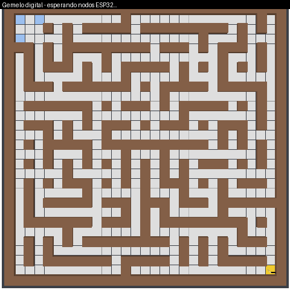

# Enjambre de 3 carritos con ACO en ESP32 y gemelo digital en PyBullet (Docker)

Simulación completa de la arquitectura de la actividad:

| Bloque del diagrama | Servicio Docker | Qué hace |
|---|---|---|
| **Mundo físico** (3 ESP32) | `esp32_1`, `esp32_2`, `esp32_3` (`node/node_esp32.py`) | Cada nodo corre su propio ACO (Python puro, sin numpy, estilo MicroPython) desde su punto de salida hasta la meta y publica sus rutas por la red. |
| **Parte de red** (ESP modo AP) | `ap` (`ap/ap_relay.py`) | Relé UDP en `192.168.4.1` (como un SoftAP): reenvía cada mensaje a las demás estaciones con latencia, jitter y pérdida configurables. |
| **Parte virtual** (Docker) | `twin` (`twin/twin.py`) | Laberinto y 3 robots en PyBullet. Recibe las feromonas por red (mapa de calor), recibe las rutas finales y los robots virtuales las recorren. Visor web en el puerto 8080. |

## Ejecutar

```bash
docker compose up --build
# abrir http://localhost:8080  (visor en vivo)
```

Los resultados quedan en `./out/`: `simulation.gif`, `results.json`, `convergence.csv`,
`convergence.png`, `latest.png`. Para repetir: `docker compose down && docker compose up`.
Todo se puede variar con un archivo `.env` (`MAZE_SEED`, `MAZE_CELLS_W/H`, `MAZE_BRAID`,
`AP_LOSS`, `AP_LATENCY_MS`, `SEED`…).

Sin Docker (depuración): `pip install numpy pillow matplotlib pybullet && ./run_local.sh`.

## Flujo de la simulación

1. Los nodos se asocian al AP (`hello`). Cuando el gemelo ve los 3, envía `go`.
2. **ACO** en cada nodo (10 hormigas/iteración, α=1, β=2, ρ=0.2, límites MAX-MIN, depósito por ranking
   + mejor global, retroceso en callejones sin salida). Cada iteración publica su mejor ruta (`pher`);
   los otros nodos depositan feromona con ella (peso 0.5) → **intercambio de feromonas por red**.
3. Al converger (sin mejora en 50 iteraciones, mínimo 80) el nodo publica `route` hasta recibir `ack`.
4. El gemelo pinta feromonas (naranja), y con las 3 rutas lanza la **simulación física**: 3 robots
   virtuales (rojo, verde, azul) siguen su ruta hasta la meta. Se compara con la ruta óptima (BFS).

Protocolo (JSON sobre UDP): `hello`, `go`, `pher {n,i,len,b,p}`, `route {n,i,len,p}`, `ack`.
Un ESP32 real que hable este protocolo en la red `192.168.4.x` podría reemplazar a un nodo simulado.

## Resultado de una corrida de referencia (laberinto 29×29, semilla 7)

| Robot | Ruta ACO | Óptima (BFS) | Llegada (t sim.) |
|---|---|---|---|
| 1 | 57 celdas | 57 | 24.9 s |
| 2 | 55 celdas | 55 | 24.1 s |
| 3 | 55 celdas | 55 | 24.2 s |

ACO es estocástico: en otras corridas una ruta puede quedar 1–2 celdas por encima del óptimo;
`results.json` indica `is_optimal` y `optimality_ratio` por robot.

## Estructura

```
docker-compose.yml   ap/  node/  twin/  common/ (maze.py, net.py)
run_local.sh         out/ (resultados de ejemplo)   logs/
```

