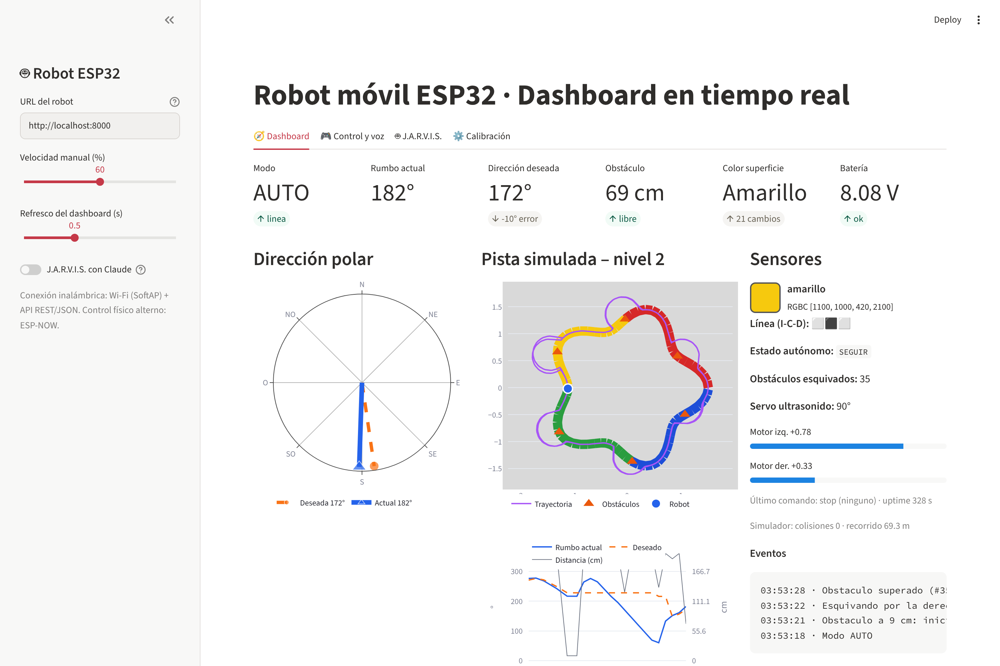
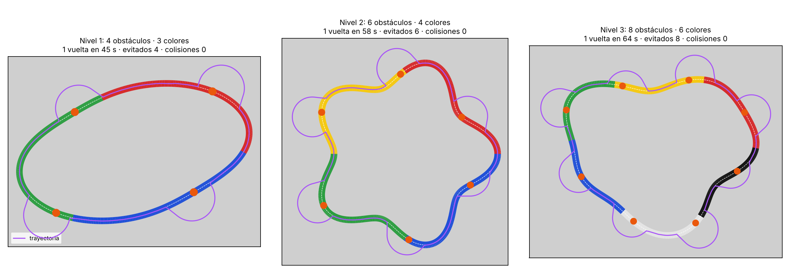

# Robot móvil ESP32 – Proyecto Final (Primer Entregable, Corte 2)

Robot 4WD basado en **ESP32**, con chasis y electrónica de diseño propio. Funciona en modo **manual**
(comandos de voz desde una app Streamlit o un control remoto propio con ESP32 vía ESP-NOW) y en modo
**autónomo**: sigue la pista, se orienta con una **brújula digital QMC5883L**, detecta en tiempo real los
**cambios de color** de la superficie (negro, blanco, rojo, amarillo, verde, azul) con un TCS34725 y
**esquiva obstáculos** con un HC-SR04 sobre servo, para luego retomar el trayecto. Un chatbot
**J.A.R.V.I.S.** explica el proyecto y las variables en tiempo real.

📄 **Informe del entregable:** [`docs/Informe_Primer_Entregable.pdf`](docs/Informe_Primer_Entregable.pdf)



## Estructura

```
robot-esp32/
├── firmware/
│   ├── robot_esp32/        firmware del robot (Arduino-ESP32 core >= 3.0)
│   │   ├── config.h          pines, umbrales, ganancias, red
│   │   ├── motors.h          TB6612FNG, mezcla diferencial
│   │   ├── compass.h         QMC5883L + calibración hard/soft-iron (NVS)
│   │   ├── color_sensor.h    TCS34725, clasificación de 6 colores
│   │   ├── sensors.h         HC-SR04 + servo, TCRT5000, batería
│   │   └── robot_esp32.ino   lazo 20 Hz, máquina de estados, API HTTP, ESP-NOW
│   └── control_remoto/     control propio: ESP32 + joystick (ESP-NOW)
├── app/
│   ├── app.py              dashboard Streamlit (control, voz, brújula polar, J.A.R.V.I.S.)
│   ├── commands.py         intérprete de comandos de voz en español
│   ├── robot_client.py     cliente de la API del robot
│   ├── jarvis.py           chatbot (Claude API o motor de reglas local)
│   ├── simulator.py        gemelo digital con la MISMA API del firmware (niveles 1–3)
│   └── tests/              pytest (intérprete de voz + simulador)
├── hardware/cad/           chasis.scad (OpenSCAD paramétrico), DXF corte láser, STL impresión 3D
└── docs/                   informe PDF, figuras y scripts que los generan
```

## Puesta en marcha

### 1. Firmware
1. Arduino IDE → instalar *esp32 by Espressif* (≥ 3.0). Placa: **ESP32 Dev Module**.
2. Abrir `firmware/robot_esp32/robot_esp32.ino`, revisar `config.h` y cargar.
3. El robot crea la red **ROBOT-ESP32** (clave `robot1234`); API en `http://192.168.4.1`.
   Sin la app, `http://192.168.4.1/` muestra un control de respaldo.
4. Control remoto: cargar `firmware/control_remoto/control_remoto.ino` en el segundo ESP32.

### 2. App Streamlit
```bash
cd app
pip install -r requirements.txt
streamlit run app.py              # conectado a la red ROBOT-ESP32
```
Para J.A.R.V.I.S. con Claude: `export ANTHROPIC_API_KEY=...` (sin clave usa un motor de reglas local).
El reconocimiento de voz usa el servicio de Google (requiere internet en el equipo que corre la app).

### 3. Sin hardware: gemelo digital
```bash
cd app
python simulator.py --nivel 2                         # nivel 1, 2 o 3 de la meta final
ROBOT_URL=http://localhost:8000 streamlit run app.py
python -m pytest -q tests                             # 22 pruebas
```

### 4. Regenerar figuras, CAD e informe
```bash
python docs/generar_diagramas.py      # requiere graphviz, schemdraw, matplotlib
python docs/generar_informe.py        # requiere reportlab
openscad -D 'PARTE="base_2d"' -o hardware/cad/placa_base.dxf hardware/cad/chasis.scad
```

## API del robot (ESP32 y simulador)

| Endpoint | Parámetros | Acción |
|---|---|---|
| `GET /api/state` | — | Telemetría JSON (rumbo actual/deseado, distancia, color, línea, motores, batería, estado, eventos) |
| `GET /api/cmd` | `move=forward\|backward\|left\|right\|stop`, `speed`, `ms` | Movimiento manual por pulsos |
| `GET /api/mode` | `m=auto\|manual\|pausa\|reanudar`, `nav=linea\|rumbo` | Modo de operación |
| `GET /api/heading` | `deg` o `rel` | Dirección polar deseada |
| `GET /api/speed` | `v=20..100` | Velocidad autónoma |
| `GET /api/calibrate` | `what=compass` o `what=color&name=rojo` | Calibración |

## Conexiones principales

| Señal | GPIO | | Señal | GPIO |
|---|---|---|---|---|
| PWMA/AIN1/AIN2 | 25/26/27 | | SDA/SCL (brújula + color) | 21/22 |
| PWMB/BIN1/BIN2 | 14/33/32 | | TRIG/ECHO (divisor 1k/2k) | 18/19 |
| STBY | 13 | | Servo | 23 |
| IR izq/centro/der | 34/35/39 | | LED del sensor de color | 4 |
| VBAT (100k/33k) | 36 | | LED de estado | 2 |

## Resultados en simulación (una vuelta por nivel)

| Nivel | Obstáculos | Colores | Tiempo | Esquivados | Colisiones |
|---|---|---|---|---|---|
| 1 | 4 | 3 | 45 s | 4 | 0 |
| 2 | 6 | 4 | 58 s | 6 | 0 |
| 3 | 8 | 6 | 64 s | 8 | 0 |



**Pendiente (siguiente corte):** compra/fabricación, ensamble, carga del firmware en la placa,
calibración en pista y pruebas físicas por nivel (plan en la sección 9.3 del informe).
